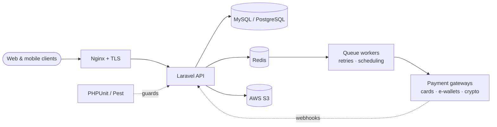
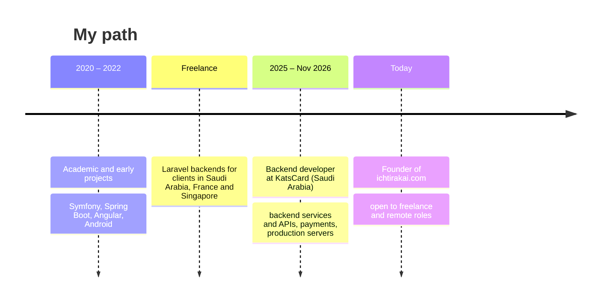

  

Freelance **backend developer** from Tunisia. I've spent about 5 years building production systems, mainly with **Laravel / PHP**.
I also work with Python, Symfony, C#/.NET, Vue and Angular. Founder of [ichtirakai.com](https://ichtirakai.com).

#### What I've shipped to production

- **Payments**: gateway integrations for cards, e-wallets and crypto, with webhooks, idempotency and reconciliation
- **Background processing**: Redis and Laravel queues, workers, retries and scheduled jobs
- **Quality**: automated tests with PHPUnit and Pest
- **Ops**: deployments on AWS and Linux VPS with Nginx, PHP-FPM, systemd, Docker, TLS and monitoring

  

#### How I build backends

#### Experience

#### Projects

<table>
<tr>
<td width="33%" valign="top"> <b><a href="https://ichtirakai.com">ichtirakai.com</a></b> My company. An Arabic store for AI and software subscriptions (ChatGPT, Gemini, CapCut, Microsoft 365…) with crypto payments and fast delivery.</td>
<td width="33%" valign="top"> <b><a href="https://mauss.mooo.com">Kats Screen</a></b> An Arabic streaming platform for movies, series and anime, with profiles and real-time watch parties.</td>
<td width="33%" valign="top"> <b><a href="https://openopc.mooo.com">1Stake</a></b> A Laravel online-casino platform that records deposits and withdrawals on the Polygon blockchain.</td>
</tr>
</table>

**Open source:** [tivideo](https://github.com/ghassendev/tivideo) (Quran reels generator: Next.js + Remotion) · [recordedit](https://github.com/ghassendev/recordedit) (AI video montage: Laravel + Python) · [brain](https://github.com/ghassendev/brain) (AI coding-agent control room) · [kick](https://github.com/ghassendev/kick) (Kick OAuth chat app)

#### Activity

  

  <picture>
    <source media="(prefers-color-scheme: dark)" srcset="https://raw.githubusercontent.com/ghassendev/ghassendev/output/github-snake-dark.svg" />
    <source media="(prefers-color-scheme: light)" srcset="https://raw.githubusercontent.com/ghassendev/ghassendev/output/github-snake.svg" />
    
  </picture>

#### Contact

📫 [ghassengharsseloui@gmail.com](mailto:ghassengharsseloui@gmail.com) · open to freelance and remote backend roles

Charts are generated from my own data: the language breakdown comes from the code of my production projects, and the activity chart and snake are rebuilt automatically by GitHub Actions in this repo.
