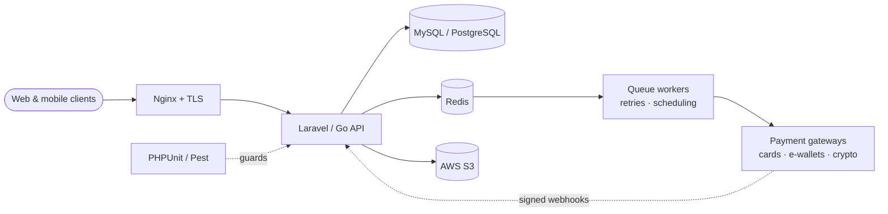
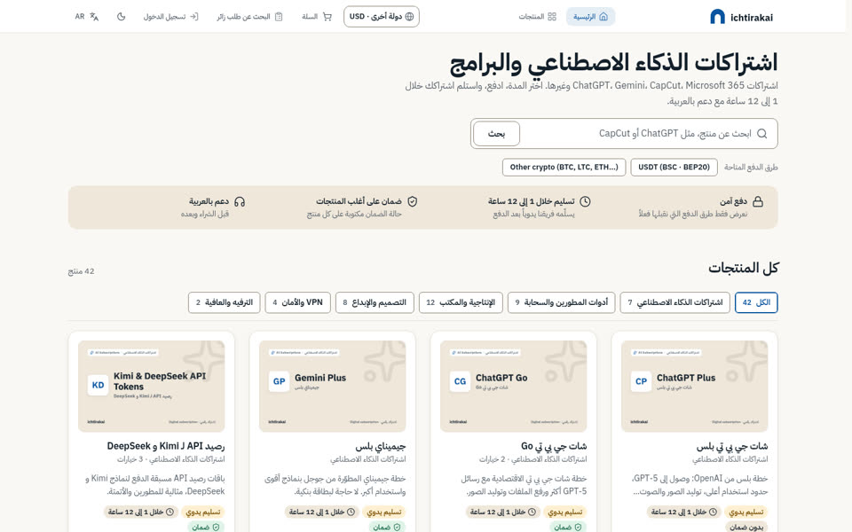
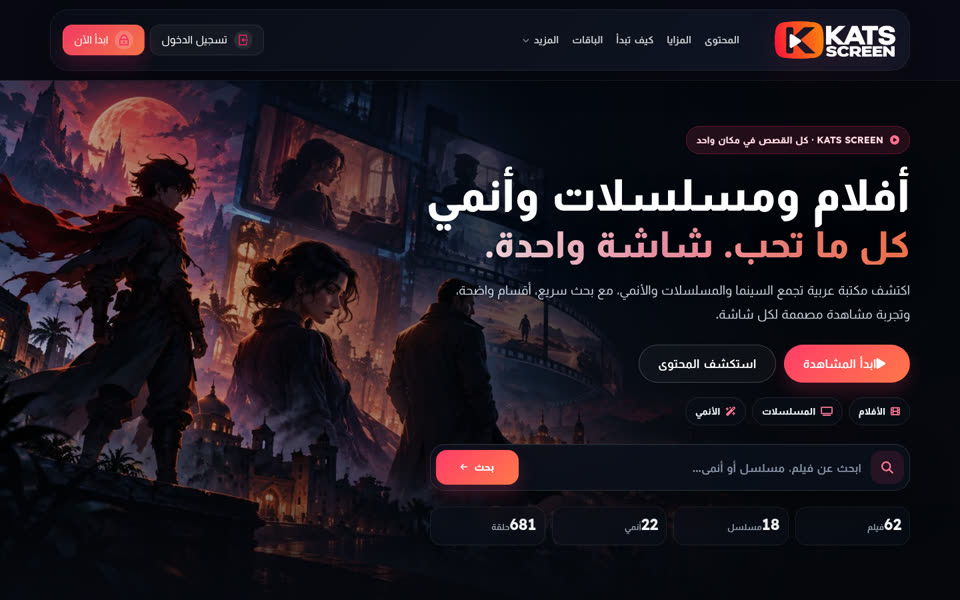
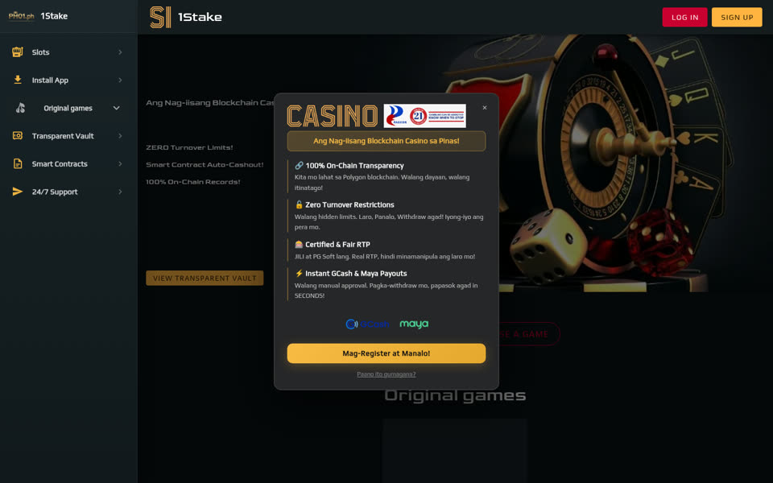

  

  

I'm a freelance **backend developer** from Tunisia with **5+ years** of shipping production systems, mainly in **Laravel / PHP**.
I also work with Python, Go, Symfony, C#/.NET, Vue, React and Angular. I design the backend, integrate the payments, write the tests and run the servers myself. I'm the founder of [ichtirakai.com](https://ichtirakai.com).

#### What I bring

- **Payments**: card, e-wallet and crypto gateways with signed webhooks, idempotency and reconciliation. 40 gateways run across the platforms I maintain, including Stripe, PayPal, NOWPayments, USDT, Razorpay and Paystack.
- **Background processing**: Laravel queues, Redis and Asynq, with workers, retries, scheduled jobs and long-running media pipelines.
- **Quality**: PHPUnit and Pest in 18 repositories, plus pytest, Vitest and Go tests.
- **Ops**: AWS and Linux VPS. Nginx, PHP-FPM, systemd, PM2, Docker, TLS, backups to cloud storage and scripted cut-overs.
- **Modern stack**: Go and Vue 3 storefronts, Next.js 16 with Remotion video rendering, and LLM pipelines with Claude.

  

  

#### Selected work

| Project | What it does | Stack |
|---|---|---|
| **[ichtirakai.com](https://ichtirakai.com)** · my company | Arabic store for AI and software subscriptions. I added a NOWPayments gateway, RTL/bidi support and a new design system, and moved it from Docker to native systemd with a scripted cut-over | Go · Gin · Asynq · Redis · Vue 3 · TypeScript |
| **[Kats Screen](https://mauss.mooo.com)** | Arabic streaming platform: viewer app, admin studio, real-time watch parties, and cron workers that move media to cloud storage | PHP 8.4 · Ratchet WebSockets · MySQL · Twig |
| **[1Stake](https://openopc.mooo.com)** | Online-casino platform where every deposit and withdrawal is also written to the Polygon blockchain as a public audit trail | Laravel 11 · Reverb · Redis · ethers.js · Node |
| **HR management SaaS** | Multi-tenant HRM: employees, payroll, leave, recruitment and subscription plans across 29 payment gateways | Laravel 12 · Inertia · React 19 · TypeScript |
| **[AutoEdit](https://github.com/ghassendev/recordedit)** | Turns raw screen recordings into edited, captioned videos. A Laravel queue drives a Python and FFmpeg pipeline, with cuts planned by Claude | Laravel 13 · Python · FFmpeg · Claude |
| **[Quran Reels](https://github.com/ghassendev/tivideo)** | Self-hosted generator of vertical videos with word-synced text and a low-resource render worker | Next.js 16 · Remotion · Prisma · SQLite |
| **[Agent HQ](https://github.com/ghassendev/brain)** | Control room that plans, runs, verifies and reviews AI coding-agent tasks | TypeScript · PocketBase · React · PixiJS |
| **Recruitment radar** | Finds job offers in Facebook groups, classifies them with AI and sends Telegram alerts and WhatsApp outreach | Python · Flask · SQLite · Gunicorn |

  

#### How I build backends

#### Live products

<table>
<tr>
<td width="33%" valign="top"> <b><a href="https://ichtirakai.com">ichtirakai.com</a></b> My company. An Arabic store for AI and software subscriptions (ChatGPT, Gemini, CapCut, Microsoft 365…) with crypto payments and fast delivery.</td>
<td width="33%" valign="top"> <b><a href="https://mauss.mooo.com">Kats Screen</a></b> An Arabic streaming platform for movies, series and anime, with profiles and real-time watch parties.</td>
<td width="33%" valign="top"> <b><a href="https://openopc.mooo.com">1Stake</a></b> A Laravel online-casino platform that records deposits and withdrawals on the Polygon blockchain.</td>
</tr>
</table>

#### Activity

  

  <picture>
    <source media="(prefers-color-scheme: dark)" srcset="https://raw.githubusercontent.com/ghassendev/ghassendev/output/github-snake-dark.svg" />
    <source media="(prefers-color-scheme: light)" srcset="https://raw.githubusercontent.com/ghassendev/ghassendev/output/github-snake.svg" />
    
  </picture>

#### Contact

📫 [ghassengharsseloui@gmail.com](mailto:ghassengharsseloui@gmail.com) · open to freelance and remote backend roles

Every number above comes from my own code: the skills counts are repositories using each technology, the language chart measures the code of my production projects, and the activity chart and snake are rebuilt daily by GitHub Actions in this repo.
